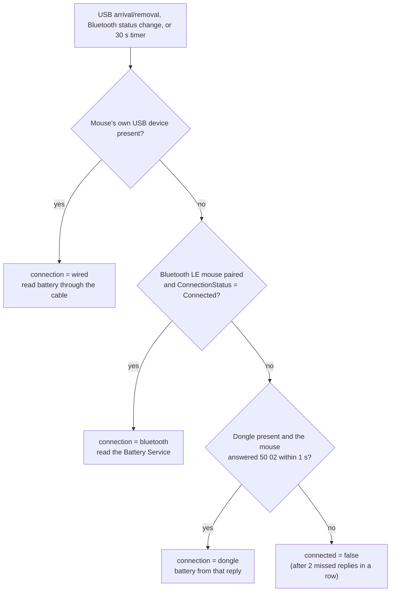
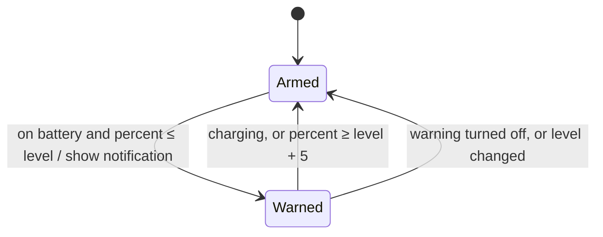

# Mouse battery, low battery warning and connection type: the engine side

The Mouse page (`ui/`) can now show the battery, warn when it runs low, and name the link the
mouse is using: the 2.4 GHz dongle, Bluetooth or the USB cable. The page can only display what
the engine sends, though. Today the engine sends no battery level, and it reports "wireless"
whenever the dongle is present, so a mouse switched to Bluetooth still reads as "through the
USB dongle". This note describes the engine work that closes that gap. Section 1 is the contract
with the page; sections 2 to 4 explain how to get each value on Windows; section 5 is a test plan.

Nothing below has been run against the real mouse yet. The dongle commands come from two
independent Linux tools that read the Haste 2 Wireless battery (credited in section 3), and the
Bluetooth part uses the standard Bluetooth Battery Service. Every point that still needs
checking on the hardware is marked **verify**.


## 1. What the page expects

### The `mouse` object

`getState().mouse` and every `mouse` event carry these fields. The new ones are marked.

```jsonc
{
  "model": "Pulsefire Haste 2",
  "connected": true,                          // the mouse itself answers, not just the dongle
  "connection": "dongle",                     // NEW: "dongle" | "bluetooth" | "wired"
  "wireless": true,                           // keep for older pages: connection !== "wired"
  "battery": 64,                              // NOW FILLED: 0-100, or null until the first reading
  "charging": false,                          // NEW
  "batteryAlert": { "on": true, "at": 20 },   // NEW: saved setting, at = 5..50 in steps of 5
  "stages": [ ... ], "active": 2, "polling": 1000, "lighting": { ... }
}
```

Push a `mouse` event whenever `connected`, `connection`, `battery` or `charging` changes. The
page updates the Mouse page, the title bar and the Rig page from that event, so there is no need
to resend an unchanged reading.

If `connection` is missing, the page falls back to the old `wireless` flag and says just
"Wireless." rather than guessing which wireless link it is.

### New calls from the page

| Call | What the engine does |
|---|---|
| `setBatteryAlert({ on, at })` | Save the setting, re-check the current level against it (section 4), push `mouse`. Return `null`, or `{ message }` to show the user a notice. |
| `testBatteryAlert()` | Show the low battery notification now, with the current level, so the user can see what it looks like and that Windows isn't hiding it. Return `null`. |

An engine without these calls rejects them, and the page then says the feature needs a newer
version. Nothing breaks.

### Events the page already understands

The warning should also reach the page while it is open: send the existing `toast` event with
the same text as the Windows notification.


## 2. Telling the three links apart

### Why "wireless" isn't enough

The engine sees the dongle as a USB device that stays plugged in whatever the mouse is doing.
When the mouse is switched to Bluetooth, or simply turned off, the dongle is still there. So
"the dongle is present" says nothing about where the mouse is. The engine needs evidence that
the mouse itself is on a given link:

- **Cable.** With the cable in, the mouse appears as its own USB device, with a product id
  different from the dongle's. That device existing is enough.
- **Bluetooth.** Windows keeps a paired Bluetooth mouse listed even while it is off or on
  another link, so a listing isn't enough. The engine has to ask Windows whether the Bluetooth
  connection is up (`BluetoothLEDevice.ConnectionStatus`, section 3.2).
- **Dongle.** The dongle relays requests to the mouse. If the mouse answers the battery request
  (section 3.1), it is on the dongle. If only the dongle is there and nothing answers, the mouse
  is asleep, off, or on Bluetooth.

### How each link looks to Windows

Each link shows up as a HID device path, which is the string the engine opens:

| Link | What the HID device path contains |
|---|---|
| Dongle | `vid_03f0&pid_<dongle pid>&mi_02` (interface 2 is the vendor interface the engine already writes to) |
| Cable | `vid_03f0&pid_<mouse pid>&mi_02` |
| Bluetooth LE | `{00001812-0000-1000-8000-00805f9b34fb}`, the HID-over-GATT service id, followed by `_dev_vid&0203f0_pid&<pid>` |
| Bluetooth Classic (unlikely for this mouse) | `{00001124-0000-1000-8000-00805f9b34fb}` |

The engine already knows the dongle and cable product ids it matches today. The Linux tools list
`03F0:0F98` for the Haste 2 Wireless dongle. A tri-mode model may use other ids, so log every HID
path containing `03f0` once at start (**verify**). Only the two USB rows matter for the decision
below; Bluetooth is decided through the WinRT API, not by parsing its path.

### Deciding, in order

Check the links in this order. Each link wins only if it has live evidence, and the order puts
the cheapest and most certain evidence first.



Re-run the decision on USB arrival or removal, on the Bluetooth `ConnectionStatusChanged` event,
and on a 30 second timer. Switching between dongle and Bluetooth then shows up immediately,
because one of those events fires. Only "the mouse went to sleep" waits for the timer. That case
needs two missed replies in a row before `connected` turns false, so a single dropped report
doesn't make the mouse flicker to "Not found".


## 3. Reading the battery

### 3.1 Through the dongle or the cable

The mouse answers a vendor request on the same interface the engine already uses for DPI and
polling rate (interface 2). The exchange is one 64-byte output report and one input report back:

```
request (output report, 64 bytes):  50 02 00 00 00 ... 00
reply   (input report):             51 02 PP CC SS ...
                                    │  │  │  │  └─ power source: 00 = on the cable, FF = on battery
                                    │  │  │  └──── charge state: 01 (also 02 on some firmware) = charging
                                    │  │  └─────── battery percent, 0-100
                                    └──┴────────── report id 0x51, same subcommand 0x02 as the request
```

Byte 0 is the HID report id, which is how the engine's existing 64-byte commands are built too.
On Windows the buffer must be exactly the interface's `OutputReportByteLength` (64 here), with
`0x50` in byte 0.

Sources: [Emanuel4100/omarchy-hyperx-battery](https://github.com/Emanuel4100/omarchy-hyperx-battery)
and [czQery/waybar-hyperx-haste2](https://github.com/czQery/waybar-hyperx-haste2). Both are Linux
tools for the Haste 2 Wireless dongle (`03F0:0F98`, interface 2) that send this request and read
the percent from the byte after `51 02`. Only the first reads the charging bytes. Its README and
its code disagree on whether `CC = 02` means charging, and neither project cites a spec, so treat
the charging bytes as **verify**. The percent byte is confirmed by both.

Three practical points about the exchange on Windows:

1. **Clear old reports first.** Windows queues input reports, so an old `51 02` reply could be
   read as a new one. Call `HidD_FlushQueue(handle)` before writing the request.
2. **Search the replies, don't assume the first one.** The mouse also sends other input reports,
   such as acknowledgements and the `0x45` notifications. Read reports for up to 1 second and take
   the first one whose bytes 0 and 1 are `51 02` and whose byte 2 is at most 100.
3. **Share the engine's existing lock.** If the engine already reads acknowledgements from this
   interface for DPI writes, send the battery request through the same queue or lock, so a DPI
   write and a battery poll can't take each other's replies.

```csharp
// Sketch: plug into the engine's existing vendor-interface write/read (names are placeholders).
static readonly byte[] BatteryRequest = MakeRequest();
static byte[] MakeRequest() { var b = new byte[64]; b[0] = 0x50; b[1] = 0x02; return b; }

struct BatteryReading { public int Percent; public bool Charging; }

// Returns null when the mouse didn't answer: asleep, off, or on another link.
BatteryReading? PollBattery(VendorInterface hid)
{
    lock (hid.Sync)
    {
        hid.FlushQueue();                              // HidD_FlushQueue
        hid.Write(BatteryRequest);
        var until = DateTime.UtcNow.AddSeconds(1);
        while (DateTime.UtcNow < until)
        {
            byte[] r = hid.Read(until - DateTime.UtcNow);   // one input report, or null on timeout
            if (r == null) break;
            if (r.Length >= 5 && r[0] == 0x51 && r[1] == 0x02 && r[2] <= 100)
            {
                byte cc = r[3], ss = r[4];
                // verify: from one tool's reading of the bytes, not a spec
                bool charging = ss == 0x00 || (ss != 0xFF && (cc == 0x01 || cc == 0x02));
                return new BatteryReading { Percent = r[2], Charging = charging };
            }
        }
        return null;
    }
}
```

With the cable in, send the same request to the mouse's own USB device (its interface 2). That
the cable answers the same way is very likely, but it is **verify**. If it does, `charging` will
come back true there.

How often to poll: every 30 seconds, plus once straight away on any of the events in section 2.
These mice run for days on a charge, so 30 seconds is far more than the level needs. The
interval is set by how quickly the page should notice that the mouse went to sleep.

### 3.2 Over Bluetooth

The `50 02` request only works over Bluetooth if the mouse also exposes its vendor HID collection
there, and that isn't known (see the end of this section). Bluetooth Low Energy mice publish their
charge in a standard way instead: the **Battery Service** (service `0x180F`, Battery Level
characteristic `0x2A19`, one byte, 0-100). Windows Settings reads the same service to show a
Bluetooth device's battery. The engine reads it with the WinRT Bluetooth API.

The engine targets .NET Framework 4.7.2, so add the NuGet package
`Microsoft.Windows.SDK.Contracts`, version 10.0.19041.x or newer, as a `PackageReference`. That
package exposes `Windows.Devices.*` and the `.AsTask()` adapters to a desktop app.

```csharp
using Windows.Devices.Bluetooth;
using Windows.Devices.Bluetooth.GenericAttributeProfile;
using Windows.Devices.Enumeration;
using Windows.Storage.Streams;

// Find the paired mouse. Log info.Name for every paired device once (verify the name).
static async Task<BluetoothLEDevice> FindBleMouseAsync()
{
    string paired = BluetoothLEDevice.GetDeviceSelectorFromPairingState(true);
    foreach (var info in await DeviceInformation.FindAllAsync(paired).AsTask())
    {
        string n = info.Name ?? "";
        if (n.IndexOf("Pulsefire", StringComparison.OrdinalIgnoreCase) >= 0 ||
            n.IndexOf("HyperX", StringComparison.OrdinalIgnoreCase) >= 0)
            return await BluetoothLEDevice.FromIdAsync(info.Id).AsTask();
    }
    return null;
}

// Null when the service can't be read; log r.Status so a failure can be diagnosed.
static async Task<int?> ReadBleBatteryAsync(BluetoothLEDevice dev)
{
    var svc = await dev.GetGattServicesForUuidAsync(GattServiceUuids.Battery, BluetoothCacheMode.Uncached).AsTask();
    if (svc.Status != GattCommunicationStatus.Success || svc.Services.Count == 0) return null;
    var ch = await svc.Services[0].GetCharacteristicsForUuidAsync(GattCharacteristicUuids.BatteryLevel).AsTask();
    if (ch.Status != GattCommunicationStatus.Success || ch.Characteristics.Count == 0) return null;
    var r = await ch.Characteristics[0].ReadValueAsync(BluetoothCacheMode.Uncached).AsTask();
    if (r.Status != GattCommunicationStatus.Success || r.Value.Length < 1) return null;
    return DataReader.FromBuffer(r.Value).ReadByte();
}
```

Keep the `BluetoothLEDevice` object alive. Subscribe to `ConnectionStatusChanged` and re-run the
link decision from that handler, which is what makes a switch to or from Bluetooth appear at
once. If the Battery Level characteristic supports notifications (its `CharacteristicProperties`
include `Notify`), also subscribe to `ValueChanged` for instant updates. Otherwise the 30 second
timer covers it. A mouse charging on the cable is on the wired link, not Bluetooth, so over
Bluetooth `charging` is always `false`.

Run these calls off the window's thread (for example in `Task.Run`). Don't block on `.Result` from
the WinForms thread: the WinRT continuations need that thread back, and the app would hang.

**Other mouse settings over Bluetooth.** The DPI, polling and lighting commands go through the
vendor interface, and over Bluetooth that interface may not exist. Log which HID collections
appear under the Bluetooth device (**verify**). If there is no vendor collection, have `setStage`,
`setActiveStage` and `setMouseLighting` return
`{ message: "Connect the dongle or the cable to change this." }`. The page already shows such
messages. The polling rate buttons are already disabled over Bluetooth, because Windows and the
mouse settle the Bluetooth report rate between themselves.


## 4. The low battery warning

### Why the engine owns it

The warning has to arrive while you are in a game with Monarch in the tray, and possibly before
this window has ever been opened ("Start in the tray"). The page might not exist at that moment,
so it can't be the one watching. The engine reads the battery anyway, so it compares each reading
with the saved level and raises the notification itself.

### Warning once, not on every reading

A plain test such as "battery ≤ level, so notify" would fire on every poll once the battery is
low: every 30 seconds until the mouse dies. A test on the exact crossing ("it was above, now it
is at or below") fails the other way, because readings jitter. A battery hovering at the level
reads 20, 21, 20, 21 and would cross back and forth all day.

The fix is a small state machine with a gap between the level that warns and the level that
re-arms. That gap is called **hysteresis**: the input has to move clearly past the threshold
before the state flips back.



With a level of 20%: the reading drops to 20 and the warning fires once. Readings of 21, 20, 19
change nothing, because re-arming needs 25 or a charge. Plug in the cable and the state re-arms,
so the next discharge warns again. After a restart the state starts as Armed, so a mouse that is
already low gets one warning at startup. That is useful, not noise.

Changing the setting re-arms the state and checks the current reading at once. Raising the level
from 20% to 40% while the battery is at 32% therefore warns right away, which shows the user the
new level works.

```csharp
sealed class BatteryAlert
{
    const int Rearm = 5;            // percentage points above the level before it can warn again
    bool warned;

    public bool On = true;
    public int At = 20;             // 5..50, saved with the other settings as mouseBatteryAlert

    public void SettingChanged() => warned = false;

    // Call on every reading. Returns true when the notification should be shown now.
    public bool Check(int percent, bool charging)
    {
        if (!On) { warned = false; return false; }
        if (charging || percent >= At + Rearm) { warned = false; return false; }
        if (warned || percent > At) return false;
        warned = true;
        return true;
    }
}
```

### Showing it

The engine already has a tray icon. `NotifyIcon.ShowBalloonTip` is shown by Windows 10 and 11 as
a regular notification, needs no extra packages, and works while the window is hidden. Call it on
the thread that owns the tray icon (through the form's `BeginInvoke`):

```csharp
void ShowLowBattery(int percent)
{
    string text = $"{model} is at {percent}%. Plug in the USB cable to charge it.";
    form.BeginInvoke((Action)(() => tray.ShowBalloonTip(10000, "Mouse battery low", text, ToolTipIcon.Warning)));
    SendToPage("toast", $"Mouse battery low: {percent}%. Plug in the USB cable to charge it.");
}
```

`testBatteryAlert()` calls the same method with the current percent, or with the saved level when
there is no reading yet. Windows suppresses notifications while Do not disturb or Focus is on. The
page's Test button mentions this, so the user knows where to look if nothing appears.


## 5. Checking it on the PC

1. **Ids.** At startup, log every HID path containing `03f0`, and the names of paired Bluetooth
   devices. Note which product id is the dongle and which is the cable.
2. **Dongle.** Mouse on the dongle: the log should show a `51 02` reply every 30 seconds, and the
   page should say "2.4 GHz dongle" with the level NGENUITY shows. Turn the mouse off: within
   about a minute the page should say "Not found".
3. **Bluetooth.** Pair the mouse, then switch it to Bluetooth with the dongle still plugged in:
   the page should change to "Bluetooth" at once, with the level Windows Settings shows. If the
   Battery Service read fails, the logged `GattCommunicationStatus` says why.
4. **Cable.** Plug in the cable: "USB cable", "Charging". Log bytes 3 and 4 of the reply on the
   cable and on the dongle, to confirm what the charging bytes mean.
5. **Warning.** Set the level above the current reading: one notification right away, and none
   on later polls. Plug in the cable and unplug it again: the warning is armed again. Press Test:
   a notification appears.

Once this ships, remove "Mouse battery level" from the README's NOT YET list.
